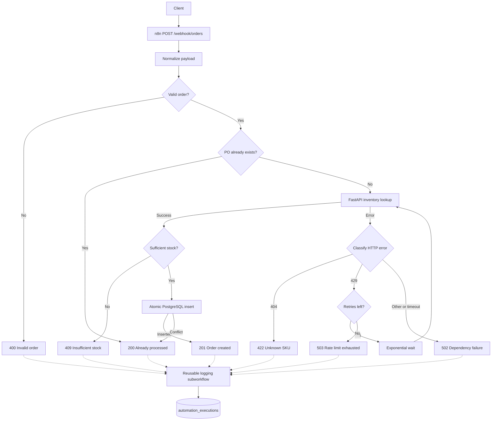

# Retail Operations Automation Platform

A production-style retail order intake and operational automation system built
with n8n, PostgreSQL, FastAPI, and Docker Compose. The current implementation
accepts purchase orders over HTTP, validates and normalizes each request,
checks inventory, protects against duplicate processing, persists accepted
orders, and records execution outcomes.

The repository currently covers the operational order path. A later phase is
planned to add Airflow and downstream analytics pipelines; those capabilities
are not implemented today.

## Architecture

The order workflow uses n8n for orchestration, PostgreSQL as the business
system of record, and a FastAPI service as a deterministic stand-in for an
external inventory dependency.



The inventory request has a three-second timeout. Inventory `404` responses
are translated into an unknown-SKU result, while `429` responses enter a
bounded retry loop with exponential waits. Exhausted rate limits receive a
controlled `503`; timeouts and other dependency errors receive `502`.

Execution logging is delegated to the reusable `02-log-execution` n8n
subworkflow instead of duplicating PostgreSQL logging logic on every outcome
branch.

## Order intake workflow

The `01-order-intake` workflow contains the following stages:

1. **Webhook ingestion** — accepts `POST` requests on `/webhook/orders`.
2. **Payload normalization** — extracts `po_number`, `retailer_name`, `sku`,
   `quantity`, and `unit_price` into a consistent shape.
3. **Validation** — requires non-empty identifiers, a positive integer
   quantity, and a non-negative numeric unit price.
4. **Early duplicate detection** — queries `orders` by `po_number` before
   calling the inventory service.
5. **Inventory lookup** — requests the SKU from the internal FastAPI service
   with explicit timeout and error-output routing.
6. **Stock validation** — compares `available_quantity` with the requested
   quantity.
7. **Atomic insertion** — executes `INSERT ... ON CONFLICT (po_number) DO
   NOTHING RETURNING ...` in PostgreSQL.
8. **Execution logging** — records the terminal outcome through the reusable
   logging workflow.
9. **HTTP response** — returns a stable status code and JSON response for each
   outcome.

The early duplicate query and database conflict handling solve different
problems. The early check avoids unnecessary inventory calls for known orders.
The `UNIQUE` constraint and atomic `ON CONFLICT` insert remain the final
concurrency-safe correctness boundary when simultaneous requests pass the
early check.

## HTTP behavior

| Status | Meaning |
| ---: | --- |
| `201` | Order created |
| `200` | Duplicate order / already processed |
| `400` | Missing or invalid order data |
| `409` | Insufficient inventory |
| `422` | SKU not found by the inventory service |
| `502` | Inventory timeout or other dependency failure |
| `503` | Inventory rate limit remained exhausted after retries |

## Reliability features

- PostgreSQL `UNIQUE` constraint on `orders.po_number`
- Atomic `INSERT ... ON CONFLICT` duplicate protection
- Three-second inventory request timeout
- Explicit rate-limit detection and bounded exponential retry/backoff
- Controlled JSON error responses for validation, inventory, and stock failures
- Reusable execution logging subworkflow
- Dockerized PostgreSQL, n8n, and inventory API services
- Exact version and digest pins for n8n `2.40.5` and PostgreSQL `16.15`
- Environment-based PostgreSQL configuration
- Persistent named volumes for PostgreSQL and n8n data

## Observability

The `automation_executions` table provides an operational audit trail for the
order workflow. The reusable logging subworkflow inserts one record for each
handled terminal path.

| Field | Purpose |
| --- | --- |
| `po_number` | Purchase-order identifier associated with the execution |
| `workflow_name` | Logical workflow name, currently `order_intake` |
| `outcome` | Terminal category such as `success`, `duplicate`, `rejected`, or `failed` |
| `error_type` | Machine-readable failure or rejection category when applicable |
| `message` | Human-readable outcome detail |
| `created_at` | PostgreSQL-generated timestamp for the log record |

## Repository structure

```text
.
|-- db/
|   |-- logging.sql              # automation_executions table
|   `-- schema.sql               # orders table and PO uniqueness constraint
|-- n8n/
|   `-- workflows/
|       |-- 01-order-intake.json
|       `-- 02-log-execution.json
|-- services/
|   `-- inventory-api/
|       |-- app.py               # FastAPI inventory dependency simulator
|       |-- Dockerfile
|       `-- requirements.txt
|-- .env.example                 # required environment variable template
|-- .gitignore
|-- docker-compose.yml
`-- README.md
```

## Running locally

Docker Desktop with Docker Compose is required.

1. Create a local environment file and replace its placeholder values:

   ```bat
   copy .env.example .env
   ```

2. Start the services:

   ```bat
   docker compose up -d
   ```

3. On a new PostgreSQL volume, create the application tables. These scripts
   are idempotent, but Compose does not apply them automatically:

   ```bat
   docker compose exec -T postgres sh -c "psql -U $POSTGRES_USER -d $POSTGRES_DB" < db\schema.sql
   docker compose exec -T postgres sh -c "psql -U $POSTGRES_USER -d $POSTGRES_DB" < db\logging.sql
   ```

4. Open n8n and import both files from `n8n\workflows\`. Configure the
   PostgreSQL credential used by the workflow nodes with host `postgres`, port
   `5432`, and the values from `.env`. Confirm that the order workflow's Log
   nodes target the imported `02-log-execution` workflow.

5. Verify the containers:

   ```bat
   docker compose ps
   ```

The workflow exports and SQL files are deployment artifacts; the current
Compose file does not import or initialize them automatically.

### Local endpoints

| Service | Endpoint |
| --- | --- |
| n8n editor | <http://localhost:5678> |
| Order webhook | <http://localhost:5678/webhook/orders> |
| Inventory lookup | <http://localhost:8000/inventory/MANGO-12PK> |
| FastAPI OpenAPI UI | <http://localhost:8000/docs> |
| PostgreSQL | `127.0.0.1:5432` |

### Current workflow export note

In the committed `01-order-intake.json`, the `Atomic INSERT Order` query refers
to an n8n node named `Edit Fields`, while the exported normalization node is
named `Normalize Order`. Rebind those expressions to `Normalize Order` after
import before treating the insert path as production-ready.

## Example order request

The following command is compatible with Windows Command Prompt:

```bat
curl.exe -X POST "http://localhost:5678/webhook/orders" ^
  -H "Content-Type: application/json" ^
  -d "{\"po_number\":\"PO-PORTFOLIO-001\",\"retailer_name\":\"Example Retailer\",\"sku\":\"MANGO-12PK\",\"quantity\":12,\"unit_price\":24.99}"
```

Use a new `po_number` to exercise the creation path. Reusing the same value
exercises idempotent duplicate handling.

## Environment configuration

The local `.env` file supplies the PostgreSQL configuration and is ignored by
Git. `.env.example` documents the required keys with non-secret placeholder
values:

- `POSTGRES_USER`
- `POSTGRES_PASSWORD`
- `POSTGRES_DB`

Do not commit real credentials. Docker Compose interpolates these variables
into the PostgreSQL service and its health check.

## Design decisions

- **n8n for operational automation:** visual, event-driven orchestration makes
  webhook routing, retries, branching, and dependency calls explicit.
- **PostgreSQL as the system of record:** relational constraints and atomic
  conflict handling provide durable, concurrency-safe order persistence.
- **FastAPI for the inventory dependency:** the small mock service provides
  deterministic stock data plus controllable `404`, `429`, `500`, `503`, and
  slow-response scenarios for workflow testing.
- **Reusable logging workflow:** centralizing log persistence keeps terminal
  branches consistent and makes logging reusable by future automations.
- **Switch for HTTP errors, IF for business decisions:** the Switch node maps
  multiple dependency status classes (`404`, `429`, fallback) cleanly, while IF
  nodes express binary decisions such as valid/invalid, duplicate/new,
  sufficient/insufficient stock, and inserted/conflicted.

## Future work

- Airflow for scheduled analytics and data pipelines
- Analytics-ready tables derived from operational data
- Automated data quality checks
- BI dashboards and operational reporting

These items are planned for the next phase and are not part of the current
runtime.
