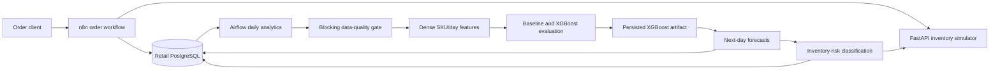
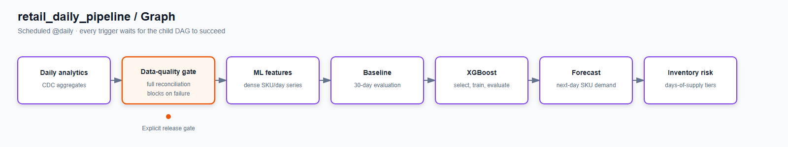

# Retail order, analytics, and demand forecasting

[](https://github.com/roger-git-427/retail_ops_automation/actions/workflows/ci.yml)

This repository combines a real-time order intake workflow with batch retail analytics, next-day SKU demand forecasting, and inventory-risk classification.

## Architecture



- **n8n** handles request-time validation, duplicate checks, inventory lookup, order insertion, responses, and execution logging.
- **Airflow** runs a scheduled controller DAG that triggers each analytics and ML stage in order, waits for completion, and stops the chain on a failed data-quality check.
- **PostgreSQL** stores operational records, aggregates, features, evaluations, forecasts, and risk outputs.
- **FastAPI** simulates the external inventory dependency used by n8n and Airflow.

n8n is used for short-lived, response-oriented operational workflows. Airflow is used for dependency-aware batch work that rebuilds aggregates, features, models, and derived outputs.

## Daily DAG graph



`retail_daily_pipeline` is the only scheduled business DAG. It uses blocking `TriggerDagRunOperator` tasks to run analytics, full data reconciliation, feature generation, baseline evaluation, XGBoost training, forecasting, and inventory risk in that order.

## Model metrics

The latest documented chronological holdout covers 2026-09-01 through 2026-09-30.

| Model | MAE | RMSE | WAPE |
| --- | ---: | ---: | ---: |
| Persistence baseline | 29.3667 | 83.7139 | 35.8762% |
| XGBoost (`xgboost_v1`) | **25.0508** | **66.6344** | **30.6036%** |

XGBoost lowers MAE by 14.7% and RMSE by 20.4% versus persistence. Metrics are stored in `ml_model_metrics`; the inspection query is in [Operations](docs/operations.md#inspection-queries).

## Components

| Path | Responsibility |
| --- | --- |
| `n8n/workflows/` | Order intake and reusable execution logging workflows |
| `airflow/dags/` | Scheduled controller, data-quality gate, analytics, ML evaluation, inference, and inventory risk |
| `db/` | Base schema, execution-log schema, and optional synthetic history |
| `services/inventory-api/` | Static inventory simulator and failure modes |
| `airflow/models/` | Runtime XGBoost artifact mount; artifacts are ignored by Git |

## Quickstart

Requirements: Docker Desktop with Docker Compose and Windows Command Prompt.

1. Create the environment file:

   ```bat
   copy .env.example .env
   ```

2. Replace every placeholder in `.env`. Use different strong values for the retail and Airflow database passwords, a valid Fernet key for `AIRFLOW_FERNET_KEY`, and a long random `AIRFLOW_JWT_SECRET`.

3. Start the services and create application tables:

   ```bat
   docker compose up -d
   docker compose exec -T postgres sh -c "psql -U $POSTGRES_USER -d $POSTGRES_DB" < db\schema.sql
   docker compose exec -T postgres sh -c "psql -U $POSTGRES_USER -d $POSTGRES_DB" < db\logging.sql
   docker compose ps
   ```

4. In n8n at <http://localhost:5678>, import both JSON files from `n8n\workflows\` and configure their PostgreSQL credentials. The order insert reads its values from the `Normalize Order` node.

5. Open Airflow at <http://localhost:8080>. Compose supplies the `retail_postgres` connection. Unpause `retail_daily_pipeline` and its seven child DAGs; the controller runs the dependency chain daily. See [Pipeline reference](docs/pipeline.md#daily-trigger-chain) for the exact order.

The inventory API is available at <http://localhost:8000/docs>. Synthetic ML history is optional and must be loaded manually; see [Operations](docs/operations.md#synthetic-data).

## Documentation

- [Architecture](docs/architecture.md)
- [Pipeline reference](docs/pipeline.md)
- [Data model](docs/data-model.md)
- [ML and forecasting](docs/ml.md)
- [Operations](docs/operations.md)
- [Scaling and trade-offs](docs/scaling-and-tradeoffs.md)
