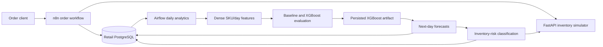

# Retail order, analytics, and demand forecasting

This repository combines a real-time order intake workflow with batch retail analytics, next-day SKU demand forecasting, and inventory-risk classification.

## Architecture



- **n8n** handles request-time validation, duplicate checks, inventory lookup, order insertion, responses, and execution logging.
- **Airflow** orchestrates scheduled analytics and manually triggered ML stages.
- **PostgreSQL** stores operational records, aggregates, features, evaluations, forecasts, and risk outputs.
- **FastAPI** simulates the external inventory dependency used by n8n and Airflow.

n8n is used for short-lived, response-oriented operational workflows. Airflow is used for dependency-aware batch work that rebuilds aggregates, features, models, and derived outputs.

## Components

| Path | Responsibility |
| --- | --- |
| `n8n/workflows/` | Order intake and reusable execution logging workflows |
| `airflow/dags/` | Daily analytics, ML features, evaluation, inference, and inventory risk |
| `db/` | Base schema, execution-log schema, and optional synthetic history |
| `services/inventory-api/` | Static inventory simulator and failure modes |
| `airflow/models/` | Runtime XGBoost artifact mount; artifacts are ignored by Git |

## Quickstart

Requirements: Docker Desktop with Docker Compose and Windows Command Prompt.

1. Create the environment file:

   ```bat
   copy .env.example .env
   ```

2. Replace every placeholder in `.env`. Use different strong values for the retail and Airflow database passwords, a valid Fernet key for `AIRFLOW_FERNET_KEY`, and a long random `AIRFLOW_JWT_SECRET`.

3. Start the services and create application tables:

   ```bat
   docker compose up -d
   docker compose exec -T postgres sh -c "psql -U $POSTGRES_USER -d $POSTGRES_DB" < db\schema.sql
   docker compose exec -T postgres sh -c "psql -U $POSTGRES_USER -d $POSTGRES_DB" < db\logging.sql
   docker compose ps
   ```

4. In n8n at <http://localhost:5678>, import both JSON files from `n8n\workflows\` and configure their PostgreSQL credentials. The order insert reads its values from the `Normalize Order` node.

5. Open Airflow at <http://localhost:8080>. Compose supplies the `retail_postgres` connection. Run the DAGs in the order documented in [Pipeline reference](docs/pipeline.md#logical-run-order).

The inventory API is available at <http://localhost:8000/docs>. Synthetic ML history is optional and must be loaded manually; see [Operations](docs/operations.md#synthetic-data).

## Documentation

- [Architecture](docs/architecture.md)
- [Pipeline reference](docs/pipeline.md)
- [Data model](docs/data-model.md)
- [ML and forecasting](docs/ml.md)
- [Operations](docs/operations.md)
