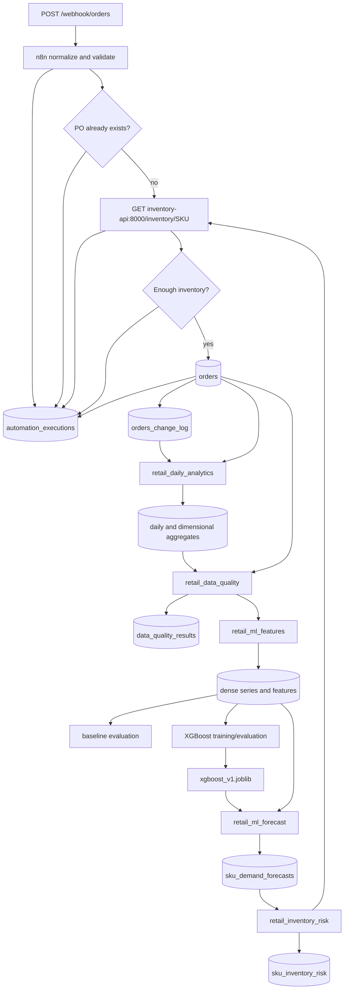

# Architecture

## Data flow

The n8n workflows are response-oriented: they validate each request, query dependencies, return an HTTP result, and log its outcome. Airflow handles batch dependencies, validation gates, chronological evaluation, model persistence, and repeatable derived tables. The scheduled `retail_daily_pipeline` controller triggers each child DAG and waits for success before releasing the next stage.

PostgreSQL is split logically, not physically: `postgres` stores application, analytics, and ML data; `airflow-postgres` stores Airflow metadata. The FastAPI service is a deterministic simulator, not an inventory system of record.

## Component responsibilities

| Component | Implemented responsibility |
| --- | --- |
| `01-order-intake` | POST webhook, field normalization, validation, duplicate lookup, inventory lookup, response classification, attempted atomic insert |
| `02-log-execution` | Reusable writer to `automation_executions` |
| `retail_daily_pipeline` | Daily cross-DAG controller; enforces stage order and propagates child failures |
| `retail_data_quality` | Full source-to-aggregate reconciliation and change-watermark gate |
| Airflow API server | Web/API endpoint and execution API |
| Airflow scheduler | LocalExecutor scheduling and task execution |
| Airflow DAG processor | Parses serialized DAG definitions |
| Retail PostgreSQL | Operational records, append-only order changes, and derived retail data |
| Airflow PostgreSQL | Airflow metadata |
| Inventory API | Three static SKU balances plus 404/429/500/503/slow simulations |

## Services, ports, and storage

| Compose service | Role | Host port | Internal hostname | Relevant volumes |
| --- | --- | --- | --- | --- |
| `postgres` | Retail database | `127.0.0.1:5432` | `postgres:5432` | `postgres_data:/var/lib/postgresql/data` |
| `n8n` | Operational workflows | `127.0.0.1:5678` | `n8n:5678` | `n8n_data:/home/node/.n8n` |
| `inventory-api` | Inventory simulator | `127.0.0.1:8000` | `inventory-api:8000` | none |
| `airflow-postgres` | Airflow metadata database | none | `airflow-postgres:5432` | `airflow_postgres_data:/var/lib/postgresql/data` |
| `airflow-init` | One-shot metadata migration | none | `airflow-init` | DAGs, logs, plugins, config, models bind mounts |
| `airflow-api-server` | Airflow UI/API | `127.0.0.1:8080` | `airflow-api-server:8080` | `./airflow/models:/opt/airflow/models` plus DAGs/logs/plugins/config |
| `airflow-scheduler` | LocalExecutor scheduler/tasks | none | `airflow-scheduler` | same Airflow bind mounts |
| `airflow-dag-processor` | DAG parsing | none | `airflow-dag-processor` | same Airflow bind mounts |

The Airflow runtime image is based on Airflow 3.3.2 and adds XGBoost 3.4.1, scikit-learn 1.9.1, pandas 3.0.6, and joblib 1.6.0.

## Startup dependencies

- `n8n` waits for the retail PostgreSQL health check.
- `airflow-init` waits for the Airflow metadata database and runs `airflow db migrate`.
- Airflow API, scheduler, and DAG processor wait for `airflow-init` to complete successfully.
- Compose injects `retail_postgres` as an Airflow JSON connection using environment values.

The controller and child DAGs must all be unpaused. A paused child produces a fast, visible controller failure instead of leaving a run waiting indefinitely.
